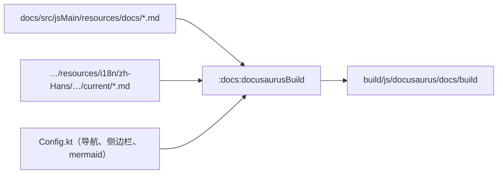

# Development

## Requirements

- JDK 17 or newer (the build uses Gradle 9.4.1).
- Node.js is downloaded by the Kotlin Gradle plugin; npm is used because Yarn is disabled in
  `gradle.properties`.
- Chromium is downloaded by Playwright the first time browser tests run. The demo's end-to-end suite is a
  Kotlin/JVM JUnit 5 test that reuses the same browser.

## Commands

```bash
./gradlew build
./gradlew :ktjs-iconify-types:jsNodeTest
./gradlew :ktjs-iconify-utils:jsBrowserTest
./gradlew :ktjs-iconify-tools:jsNodeTest
./gradlew :ktjs-iconify-icon:jsBrowserTest
./gradlew :demo:e2eTest
./gradlew :docs:docusaurusBuild     # this site
./gradlew pagesSite                 # build/pages: docs at /, demo at /demo/, Dokka at /api/
```

After adding or upgrading an npm dependency, refresh the shared lock file **before** the build that reads it:

```bash
./gradlew kotlinUpgradePackageLock
```

## Design notes

- Kotlin 2.4.21, Kotlin/JS IR, ES module output (`useEsModules()`). Browser tests run through the
  Playwright-based test DSL (`browser { test { chromium() } }`), not Karma.
- `@JsModule` declarations must stay ESM-safe: a top-level `external val` with `@JsName` becomes a default
  import, so modules with named exports only (such as `iconify-icon`) are declared as an `external object`
  with a named property.
- Browser-facing public API uses the `kotlin-browser` type system; Detekt's `ForbiddenImport` fails the build
  on `org.w3c.dom` / `kotlinx.browser` in public declarations.
- npm dependencies are pinned in `kotlin-js-store/package-lock.json`.

## Documenting



Every page has a translation under `i18n/zh-Hans/docusaurus-plugin-content-docs/current/` with the same
relative path. **Change both.** Diagrams are mermaid fenced blocks (` ```mermaid `), not images — the theme
renders them, so they follow the light/dark switch on their own.

## Publishing

There is no automated publishing workflow: releases run from a local machine, listing only the modules whose
revision changed. Every pending module must be in a single Gradle invocation, which Maven Central records as
one deployment and counts once against the monthly release limit, no matter how many modules or versions it
contains. See the `AGENTS.md` publishing section for the one-time Central Portal and GPG setup.
