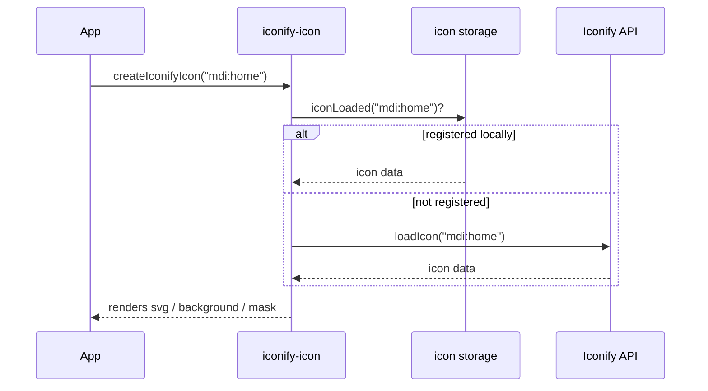

# Getting started

## Install

```kotlin
dependencies {
    implementation("io.github.shijianjs:ktjs-iconify-utils:3.1.7-kt.3")
    implementation("io.github.shijianjs:ktjs-iconify-icon:3.0.4-kt.3")
}
```

Replace the versions with the ones you need (`{upstream version}-kt.{revision}`).

## Render an icon

`ktjs-iconify-icon` is browser-only: importing it loads `iconify-icon`, which registers the `<iconify-icon>`
custom element.

```kotlin
import io.github.shijianjs.ktjs.iconify.createIconifyIcon
import web.dom.document

val element = createIconifyIcon("mdi:home") {
    width = "1em"
    height = "1em"
}
document.body?.append(element)
```

`createIconifyIcon` registers the element on first use; `registerIconifyIcon()` exists for the case where the
component has to be loaded before elements are created another way. To keep the element typed end to end:

```kotlin
import io.github.shijianjs.ktjs.iconify.IconifyIconTagName
import web.html.HtmlTagName

val typed = document.createElement(IconifyIconTagName.iconifyIcon)
```

## Icons without a network request

Icon data can be registered locally, which is what a build-time pipeline usually does:

```kotlin
import io.github.shijianjs.ktjs.iconify.IconifyIcon
import io.github.shijianjs.ktjs.iconify.addIcon
import kotlin.js.js
import kotlin.js.unsafeCast

val data = js("""({ body: '<path d="M0 0h24v24H0z"/>', width: 24, height: 24 })""")
    .unsafeCast<IconifyIcon>()
addIcon("test:home", data)
```



`loadIcon(name)` returns a promise, and `getIcon(name)` answers `null` on failure versus `undefined` when the
icon was never loaded — the difference between "not there" and "not asked for yet".

## Demo and tests

```bash
./gradlew :ktjs-iconify-icon:jsBrowserTest
./gradlew :ktjs-iconify-utils:jsBrowserTest
./gradlew :demo:e2eTest
```
