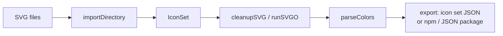

# Tools

`ktjs-iconify-tools` wraps `@iconify/tools` 5.0.14, the Node.js side of the ecosystem: scripts that read SVG
directories and emit published icon sets. The browser only needs `ktjs-iconify-utils`; this module depends on
it and adds the file-system and optimisation parts.

| Area | Representative API |
| --- | --- |
| SVG | `SVG` class: `viewBox`, `getBody`, `getIcon`, `toSvgString`, `toMinifiedString`, `toPrettyString` |
| Icon sets | `IconSet` class, `blankIconSet`, `sortThemeKeys` |
| Cleanup | `cleanupSVG`, `parseSVG`, `parseSVGStyle`, `analyseSVGStructure`, `checkBadTags`, `removeBadAttributes` |
| Optimisation | `runSVGO`, `deOptimisePaths`, `resetSVGOrigin`, `convertSVGToMask`, `scaleSVG`, `cleanupGlobalStyle` |
| Import / export | `importDirectory`, `importDirectorySync`, `exportToDirectory`, `exportIconPackage`, `exportJSONPackage`, `mergeIconSets`, `addTagsToIconSet` |
| Colours | `parseColors`, `isEmptyColor`, `validateColors`, `detectIconSetPalette` |
| Download | `downloadPackage`, `downloadNPMPackage`, `downloadGitHubRepo`, `downloadGitLabRepo`, `unzip`, `untar`, `importFromFigma` |
| Misc | `writeJSONFile`, `scanDirectory`, `compareDirectories`, `execAsync`, `cleanupIconKeyword`, `bumpVersion` |



```kotlin
import io.github.shijianjs.ktjs.iconify.tools.SVG
import io.github.shijianjs.ktjs.iconify.tools.blankIconSet
import io.github.shijianjs.ktjs.iconify.tools.cleanupSVG

val svg = SVG("""<svg xmlns="http://www.w3.org/2000/svg" viewBox="0 0 24 24"><path d="M0 0h24v24H0z"/></svg>""")
cleanupSVG(svg)

val iconSet = blankIconSet("my-icons")
iconSet.fromSVG("home", svg)
iconSet.setAlias("house", "home")

val json = iconSet.export()
```

`IconSet` covers `resolve`, `list`, `forEach`, `getTree`, `toSVG`, `toHtml`, `export`, `exists`, `remove`,
`rename`, `setIcon`, `setAlias`, `setVariation`, `fromSVG`, `chars` and the category / theme helpers.

## ESM-only upstream

`@iconify/tools` is ESM-only and its root export has no `require` condition. The wrapper imports it through
the public `@iconify/tools/lib/index.js` subpath, which works for both ES module and CommonJS consumers;
CommonJS consumers additionally need `require(ESM)` support (Node.js 20.19+, 22.12+ or 24).
