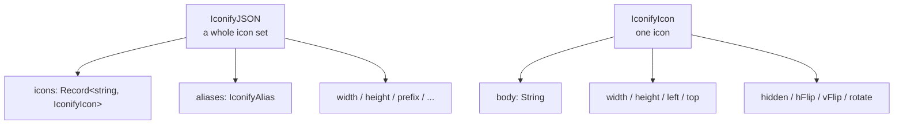

# Types

`ktjs-iconify-types` wraps `@iconify/types` 2.0.0. It carries declarations only — no runtime code — and
`ktjs-iconify-utils` re-exports it with `api` scope, so the icon data types arrive with the utils dependency.

## What the types are used for

| Type | Where it appears |
| --- | --- |
| `IconifyJSON` | the payload of `addCollection`, the argument of `getIconData` / `parseIconSet` |
| `IconifyIcon` | the value of `addIcon`, the result of `getIcon` |
| `IconifyAlias` | aliases inside a set (`setAlias` in tools) |
| Customisation records | `iconToSVG` / `mergeCustomisations` options in utils |

## Index signatures stay `dynamic`

Upstream's `Record<string, IconifyIcon>` maps cannot be expressed as a Kotlin property without inventing a
type the upstream does not have, so they stay `dynamic` in the declarations. Reading them therefore needs
`unsafeCast` — a deliberate trade: the shapes that are awkward for Kotlin are isolated here, and the rest of
the API stays typed.

The same reasoning applies to union types in utils: `number | string | null` is declared `dynamic`, because
Kotlin has no type that means exactly that.
