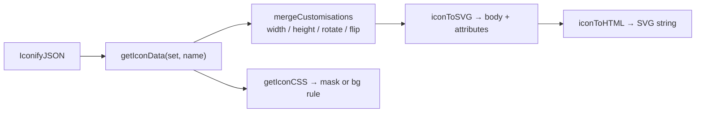

# Utils

`ktjs-iconify-utils` wraps `@iconify/utils` 3.1.7, which works in both browsers and Node.js. It re-exports
`ktjs-iconify-types` with `api` scope, so the icon data types come along.

| Area | Representative functions |
| --- | --- |
| Icon set parsing | `getIconData`, `getIcons`, `parseIconSet`, `parseIconSetAsync`, `validateIconSet`, `expandIconSet`, `minifyIconSet`, `getIconsTree` |
| Icon helpers | `mergeIconData`, `mergeIconTransformations`, `makeIconSquare`, `makeViewBoxSquare`, `stringToIcon`, `validateIconName` |
| SVG | `iconToSVG`, `iconToHTML`, `calculateSize`, `getSVGViewBox`, `svgToData`, `svgToURL`, `replaceIDs`, `trimSVG`, `encodeSvgForCss` |
| CSS | `getIconCSS`, `getIconContentCSS`, `getIconsCSS`, `getIconsContentCSS` |
| Customisations | `mergeCustomisations`, `flipFromString`, `rotateFromString`, `toBoolean` |
| Colours | `stringToColor`, `compareColors`, `colorToHexString`, `colorToString` |
| Emoji | `parseEmojiSequence`, `replaceEmojisInText`, `findAndReplaceEmojisInText` |
| Loader | `loadIcon`, `getCustomIcon`, `searchForIcon`, `mergeIconProps`, `getPossibleIconNames` |

## Generating an SVG

```kotlin
import io.github.shijianjs.ktjs.iconify.IconifyJSON
import io.github.shijianjs.ktjs.iconify.utils.getIconData
import io.github.shijianjs.ktjs.iconify.utils.iconToHTML
import io.github.shijianjs.ktjs.iconify.utils.iconToSVG
import kotlin.js.js

fun renderHome(iconSet: IconifyJSON): String {
    val icon = getIconData(iconSet, "home") ?: return ""
    val built = iconToSVG(icon, js("({ width: 48, height: 48 })"))
    return iconToHTML(built.body, built.attributes)
}
```



## Generating CSS

`getIconCSS(icon, options)` renders a rule for `bg` or `mask` mode, with the selectors defaulting to
`.icon--{prefix}` / `.icon--{prefix}--{name}`. `getIconsCSS` does the same for a whole set, which is what a
static site usually wants: one sheet, no per-icon elements.

## Options are external interfaces

Options and customisations mirror the upstream TypeScript objects, so they are built with
`js("({ ... })")` and read through typed properties.

## Mapping notes

- Union types such as `number | string | null` are declared as `dynamic`.
- `SVGViewBox` is a four-number array `[left, top, width, height]`.
- Callbacks whose `undefined` return value carries meaning (`findAndReplaceEmojisInText`, and
  `parseSVGStyle` in tools) return `dynamic` rather than `Unit`.
- Index-signature maps inside icon data stay `dynamic`, as in `ktjs-iconify-types`.
