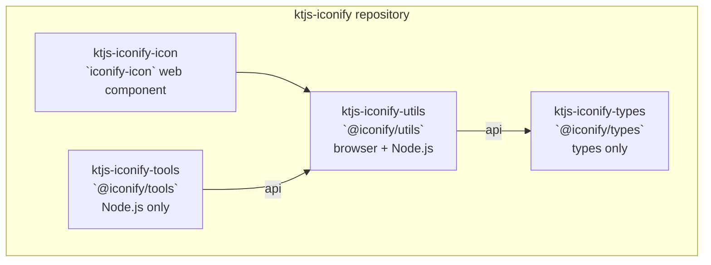
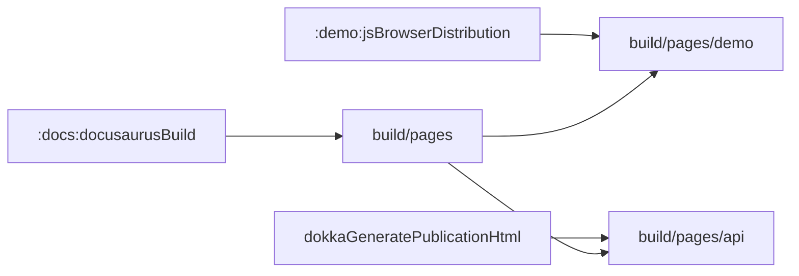

# Introduction

`ktjs-iconify` wraps the [Iconify](https://iconify.design/) npm ecosystem for Kotlin/JS. One Gradle module
per npm package, because the four upstream packages version independently.



Dependencies are declared with `api` scope, so one dependency brings the shared icon types along.

## Modules

| Module | npm package | Runtime | What it gives you |
| --- | --- | --- | --- |
| `ktjs-iconify-types` | `@iconify/types` | none (declarations only) | `IconifyJSON`, `IconifyIcon`, `IconifyAlias` and the customisation records the other modules build on. |
| `ktjs-iconify-utils` | `@iconify/utils` | browser and Node.js | Icon set parsing, SVG and CSS generation, colour and emoji helpers. |
| `ktjs-iconify-tools` | `@iconify/tools` | Node.js only | Build-time tooling: `SVG`, `IconSet`, import/export, SVG optimisation. |
| `ktjs-iconify-icon` | `iconify-icon` | browser, Web Component | The `<iconify-icon>` element plus the loader functions (`addIcon`, `loadIcon`, ...). |

## Versioning

Each module is versioned as `{upstream npm version}-kt.{revision}`:

- The upstream versions are declared once in the root `package.json`; the revision is read per module from
  `wrapper-revisions.properties`.
- Only `-kt.N` versions are published. A version without the suffix never exists.
- An upstream upgrade changes the number in `package.json`; a wrapper-only fix increments the revision
  (`kt.2`, `kt.3`, ...) and leaves the base version alone.
- Revisions only increase. A release publishes only the modules whose revision changed, so unchanged
  modules stay at their already-published version.

## Overriding an upstream version

The klib records the exact npm version it was built against, and Kotlin/JS copies that into your generated
`package.json`. To use a newer upstream release without waiting for a wrapper release, override it in the
root build script:

```kotlin
plugins.withType<NodeJsRootPlugin> {
    extensions.getByType<NpmExtension>().override("@iconify/utils", "3.2.0")
}
```

The generated root `package.json` gets an npm `overrides` entry, which wins over the exact dependency
recorded in the klib for every workspace package. Declaring a second `npm("@iconify/utils", ...)` dependency
is not a substitute: it only changes the `package.json` of the module that declares it, while other Kotlin
modules still pin the wrapper's version, so npm can install two copies.

**An override only takes effect after the lock file is rebuilt.** npm 11 does not invalidate an existing lock
when the `overrides` map changes — `npm install` reports `up to date` and keeps the previously locked
version. Delete `kotlin-js-store/package-lock.json`, run `kotlinNpmInstall`, then `kotlinUpgradePackageLock`,
and confirm the resolved version in `node_modules/@iconify/utils/package.json`.

## Where the site lives

`./gradlew pagesSite` assembles one Pages artifact out of three builds: the documentation at `/`, the demo
under `/demo/` and the Dokka HTML under `/api/`.


