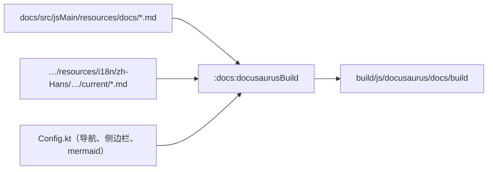

# 开发

## 环境要求

- JDK 17 或更新（构建用 Gradle 9.4.1）。
- Node.js 由 Kotlin Gradle 插件下载；`gradle.properties` 关掉了 Yarn，所以用 npm。
- 首次跑浏览器测试时 Playwright 会下载 Chromium。演示页的 e2e 是 Kotlin/JVM 上的 JUnit 5 测试，复用同一个浏览器。

## 常用命令

```bash
./gradlew build
./gradlew :ktjs-iconify-types:jsNodeTest
./gradlew :ktjs-iconify-utils:jsBrowserTest
./gradlew :ktjs-iconify-tools:jsNodeTest
./gradlew :ktjs-iconify-icon:jsBrowserTest
./gradlew :demo:e2eTest
./gradlew :docs:docusaurusBuild     # 本站
./gradlew pagesSite                 # build/pages：文档在 /、演示在 /demo/、Dokka 在 /api/
```

加了或升级了 npm 依赖，要先刷新共享 lock 文件，再跑读它的构建：

```bash
./gradlew kotlinUpgradePackageLock
```

## 设计说明

- Kotlin 2.4.21、Kotlin/JS IR、ES module 输出（`useEsModules()`）。浏览器测试走 Playwright 测试 DSL
  （`browser { test { chromium() } }`），不是 Karma。
- `@JsModule` 声明必须保持 ESM 安全：顶层 `external val` 加 `@JsName` 会变成默认导入，所以只有具名导出的模块
  （如 `iconify-icon`）声明成带具名属性的 `external object`。
- 面向浏览器的公开 API 用 `kotlin-browser` 类型体系；Detekt 的 `ForbiddenImport` 会在公开声明里出现
  `org.w3c.dom` / `kotlinx.browser` 时让构建失败。
- npm 依赖钉在 `kotlin-js-store/package-lock.json` 里。

## 写文档



每一页在 `i18n/zh-Hans/docusaurus-plugin-content-docs/current/` 下有同相对路径的译文。**两边一起改。** 图用
mermaid 围栏块（` ```mermaid `），不要贴图片——主题渲染它，亮暗切换自己会跟着变。

## 发布

没有自动发布流水线：发布在本机跑，只列修订号有变化的模块。所有待发布模块必须在同一次 Gradle 调用里，Maven
Central 会把它记成一次部署，无论多少模块、多少版本都只算一次月度额度。一次性的 Central Portal 与 GPG 配置见
`AGENTS.md` 的发布小节。
