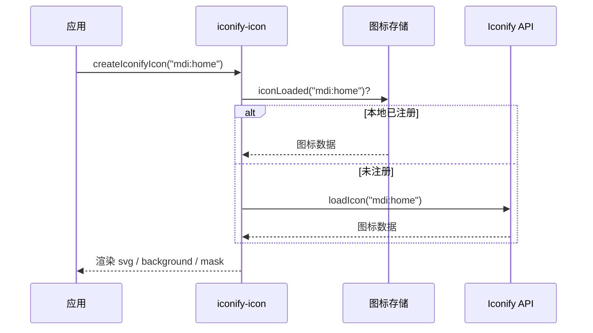

# 快速开始

## 安装

```kotlin
dependencies {
    implementation("io.github.shijianjs:ktjs-iconify-utils:3.1.7-kt.3")
    implementation("io.github.shijianjs:ktjs-iconify-icon:3.0.4-kt.3")
}
```

版本号换成你需要的那一个（`{上游版本}-kt.{修订号}`）。

## 渲染一个图标

`ktjs-iconify-icon` 只用于浏览器：import 它就会加载 `iconify-icon`，从而注册 `<iconify-icon>` 自定义元素。

```kotlin
import io.github.shijianjs.ktjs.iconify.createIconifyIcon
import web.dom.document

val element = createIconifyIcon("mdi:home") {
    width = "1em"
    height = "1em"
}
document.body?.append(element)
```

`createIconifyIcon` 在首次使用时就地注册元素；如果必须在新建元素之前先把组件加载好，用 `registerIconifyIcon()`。
要端到端都保持类型，可以：

```kotlin
import io.github.shijianjs.ktjs.iconify.IconifyIconTagName
import io.github.shijianjs.ktjs.iconify.IconifyIconTagName

val typed = document.createElement(IconifyIconTagName.iconifyIcon)
```

## 不发网络请求的图标

图标数据可以本地注册，构建期流水线通常就这么做：

```kotlin
import io.github.shijianjs.ktjs.iconify.IconifyIcon
import io.github.shijianjs.ktjs.iconify.addIcon
import kotlin.js.js
import kotlin.js.unsafeCast

val data = js("""({ body: '<path d="M0 0h24v24H0z"/>', width: 24, height: 24 })""")
    .unsafeCast<IconifyIcon>()
addIcon("test:home", data)
```



`loadIcon(name)` 返回 promise；`getIcon(name)` 失败时给 `null`，从未加载过时给 `undefined`——这正是
「没有这个图标」与「还没查过」的区别。

## 演示与测试

```bash
./gradlew :ktjs-iconify-icon:jsBrowserTest
./gradlew :ktjs-iconify-utils:jsBrowserTest
./gradlew :demo:e2eTest
```
