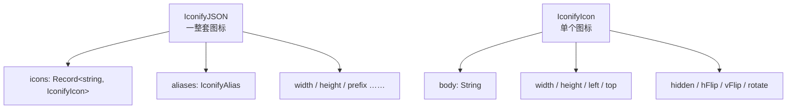

# 类型

`ktjs-iconify-types` 封装 `@iconify/types` 2.0.0。它只有声明、没有运行时，`ktjs-iconify-utils` 用 `api`
作用域再导出它，所以图标数据类型随 utils 依赖一起来。

## 这些类型用在哪

| 类型 | 出现位置 |
| --- | --- |
| `IconifyJSON` | `addCollection` 的负载、`getIconData` / `parseIconSet` 的参数 |
| `IconifyIcon` | `addIcon` 的值、`getIcon` 的结果 |
| `IconifyAlias` | 图标集里的别名（tools 的 `setAlias`） |
| 定制项记录 | utils 里 `iconToSVG` / `mergeCustomisations` 的选项 |

## 索引签名仍是 `dynamic`

上游的 `Record<string, IconifyIcon>` 映射没法在不臆造类型的前提下写成 Kotlin 属性，所以声明里保留 `dynamic`。
读取时要 `unsafeCast` —— 这是有意的取舍：别扭的那部分收在这里，其余 API 保持类型化。

utils 里的联合类型同理：`number | string | null` 声明成 `dynamic`，因为 Kotlin 没有恰好表示它的类型。
