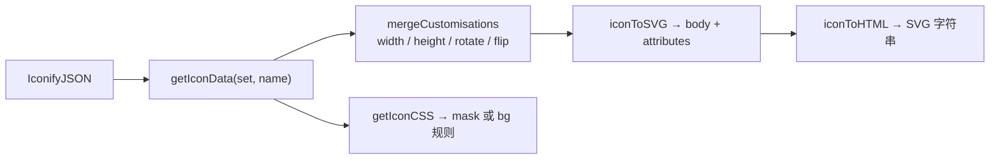

# Utils

`ktjs-iconify-utils` 封装 `@iconify/utils` 3.1.7，浏览器与 Node.js 都能用。它用 `api` 作用域再导出
`ktjs-iconify-types`，所以图标数据类型跟着一起来。

| 领域 | 代表函数 |
| --- | --- |
| 图标集解析 | `getIconData`、`getIcons`、`parseIconSet`、`parseIconSetAsync`、`validateIconSet`、`expandIconSet`、`minifyIconSet`、`getIconsTree` |
| 图标辅助 | `mergeIconData`、`mergeIconTransformations`、`makeIconSquare`、`makeViewBoxSquare`、`stringToIcon`、`validateIconName` |
| SVG | `iconToSVG`、`iconToHTML`、`calculateSize`、`getSVGViewBox`、`svgToData`、`svgToURL`、`replaceIDs`、`trimSVG`、`encodeSvgForCss` |
| CSS | `getIconCSS`、`getIconContentCSS`、`getIconsCSS`、`getIconsContentCSS` |
| 定制项 | `mergeCustomisations`、`flipFromString`、`rotateFromString`、`toBoolean` |
| 颜色 | `stringToColor`、`compareColors`、`colorToHexString`、`colorToString` |
| Emoji | `parseEmojiSequence`、`replaceEmojisInText`、`findAndReplaceEmojisInText` |
| 加载 | `loadIcon`、`getCustomIcon`、`searchForIcon`、`mergeIconProps`、`getPossibleIconNames` |

## 生成 SVG

```kotlin
import io.github.shijianjs.ktjs.iconify.IconifyJSON
import io.github.shijianjs.ktjs.iconify.utils.getIconData
import io.github.shijianjs.ktjs.iconify.utils.iconToHTML
import io.github.shijianjs.ktjs.iconify.utils.iconToSVG
import kotlin.js.js

fun renderHome(iconSet: IconifyJSON): String {
    val icon = getIconData(iconSet, "home") ?: return ""
    val built = iconToSVG(icon, js("({ width: 48, height: 48 })"))
    return iconToHTML(built.body, built.attributes)
}
```



## 生成 CSS

`getIconCSS(icon, options)` 为 `bg` 或 `mask` 模式产出一条规则，选择器默认是
`.icon--{prefix}` / `.icon--{prefix}--{name}`。`getIconsCSS` 对整套图标做同样的事——静态站点通常想要这个：
一张表，而不是每个图标一个元素。

## 选项是 external interface

选项与定制项镜像上游的 TypeScript 对象，所以用 `js("({ ... })")` 构造，再通过类型化属性读取。

## 映射说明

- `number | string | null` 这类联合类型声明为 `dynamic`。
- `SVGViewBox` 是四数字数组 `[left, top, width, height]`。
- 返回值 `undefined` 有意义的回调（`findAndReplaceEmojisInText`，以及 tools 里的 `parseSVGStyle`）返回
  `dynamic` 而不是 `Unit`。
- 图标数据里的索引签名映射和其它 `dynamic` 一样保留，见 `ktjs-iconify-types`。
