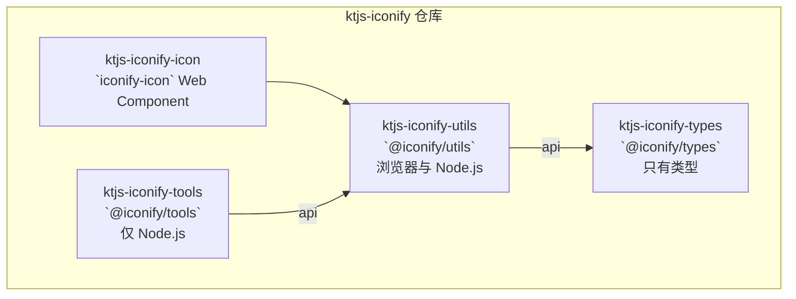
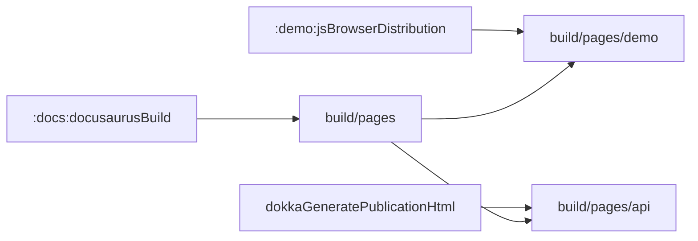

# 简介

`ktjs-iconify` 把 [Iconify](https://iconify.design/) 的 npm 生态封装成 Kotlin/JS 可用的形式。一个 npm 包对应
一个 Gradle 模块，因为四个上游包各自独立发版。



依赖用 `api` 作用域声明，所以一个依赖就把共享的图标类型带进来。

## 模块

| 模块 | npm 包 | 运行时 | 提供什么 |
| --- | --- | --- | --- |
| `ktjs-iconify-types` | `@iconify/types` | 无（只有声明） | `IconifyJSON`、`IconifyIcon`、`IconifyAlias`，以及其他模块用到的定制项记录。 |
| `ktjs-iconify-utils` | `@iconify/utils` | 浏览器与 Node.js | 图标集解析、SVG 与 CSS 生成、颜色与 emoji 辅助。 |
| `ktjs-iconify-tools` | `@iconify/tools` | 仅 Node.js | 构建期工具：`SVG`、`IconSet`、导入导出、SVG 优化。 |
| `ktjs-iconify-icon` | `iconify-icon` | 浏览器，Web Component | `<iconify-icon>` 元素与加载函数（`addIcon`、`loadIcon` ……）。 |

## 版本口径

每个模块的版本是 `{上游 npm 版本}-kt.{修订号}`：

- 上游版本在根 `package.json` 里声明一次；修订号按模块从 `wrapper-revisions.properties` 读。
- 只发布带 `-kt.N` 的版本，不带后缀的版本从未存在。
- 上游升级改 `package.json` 里的数字；仅封装侧修复时修订号加一（`kt.2`、`kt.3` ……），基础版本不动。
- 修订号只增不减。发布只上传修订号有变化的模块，未变的保持已发布版本。

## 覆盖上游版本

klib 记录了它构建时对应的 npm 版本，Kotlin/JS 会把它写进生成的 `package.json`。想用更新的上游版本而不等封装
发版，就在根构建脚本里覆盖：

```kotlin
plugins.withType<NodeJsRootPlugin> {
    extensions.getByType<NpmExtension>().override("@iconify/utils", "3.2.0")
}
```

生成的根 `package.json` 会多一条 npm `overrides`，它对工作区里每个包都优先于 klib 记录的精确依赖。再声明一个
`npm("@iconify/utils", ...)` 依赖不是等价做法：那只改声明它的那个模块的 `package.json`，其他 Kotlin 模块仍
钉着封装的版本，npm 可能装出两份。

**覆盖只有在 lock 文件重建后才生效。** `overrides` 变化时 npm 11 不会让已有 lock 失效——`npm install` 报
`up to date`，继续用之前锁定的版本。删掉 `kotlin-js-store/package-lock.json`，跑 `kotlinNpmInstall`，再跑
`kotlinUpgradePackageLock`，然后在 `node_modules/@iconify/utils/package.json` 里确认实际解析到的版本。

## 站点布局

`./gradlew pagesSite` 把三份产物拼成一个 Pages 目录：文档在 `/`，演示在 `/demo/`，Dokka 在 `/api/`。


